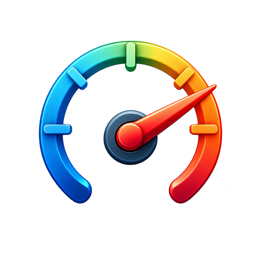

<p align="center">
  
</p>

# OpenMeter

Mierniki i czujniki telefonu w jednym miejscu – czarny interfejs AMOLED, bez reklam, open source.

Aplikacja pokazuje tylko te mierniki, dla których Twój telefon ma odpowiedni czujnik.

| Miernik | Czujnik | Co mierzy |
|---|---|---|
| Decybelomierz | mikrofon | poziom dźwięku dB(A)/dB(Z), Leq, widmo, spektrogram, dominująca częstotliwość i nuta |
| Luksomierz | światło | natężenie w lx, stopoświece, EV i czas naświetlania, zalecenia oświetlenia |
| Poziomica | grawitacja / akcelerometr | libella 2D i pozioma, spadek w % i mm/m, kalibracja |
| Kątomierz | grawitacja / akcelerometr | kąt krawędzi i nachylenie, zero względne, blokada |
| Wykrywacz metalu | magnetometr | pole w µT, odchyłka od tła, pikanie i wibracje |
| Kompas | wektor obrotu / magnetometr | azymut, kierunek, zapamiętany namiar |
| Sejsmograf | przyspieszenie liniowe | przebieg 3 osi, PGA, szacunkowa skala Mercallego |
| Drgania w podróży | przyspieszenie liniowe + grawitacja | RMS pion/poziom, komfort wg ISO 2631, widmo 1–30 Hz, wstrząsy |
| Barometr | ciśnienie | hPa, wysokość, piętra, trend 3 h, historia 24 h |
| Klimat | temperatura / wilgotność | punkt rosy, wilgotność bezwzględna |
| Obrotomierz | żyroskop | obr/min, °/s w 3 osiach |
| Krokomierz | detektor kroków | kroki, kadencja, dystans |
| Zbliżenie | zbliżeniowy | blisko/daleko, licznik gestów |
| Kąt zawiasu | zawias (foldy) | rozłożenie składanego telefonu |
| Wszystkie czujniki | – | lista czujników z parametrami i odczytem na żywo |

Każdy pomiar można nagrać przyciskiem **REC** – plik CSV trafia do listy nagrań w aplikacji i do `Pobrane/OpenMeter`.

## Instalacja

Pobierz najnowszy plik `OpenMeter-x.y.z.apk` z [Releases](https://github.com/BlackSingularities/OpenMeter/releases/latest) (Android 10+).
Aplikacja sama sprawdza nowe wydania i instaluje je jednym dotknięciem.

## Budowanie

Każdy wypchnięty tag `vX.Y.Z` buduje podpisany APK w GitHub Actions i publikuje wydanie.
Wersja pochodzi z pliku `VERSION`, opis wydania z `CHANGELOG.md`.

```bash
gradle :app:assembleDebug
```

## Licencja

MIT

---

**Projekt i wykonanie: [redzikowski.com](https://redzikowski.com)**

<a href="https://buycoffee.to/adamredzikowski" target="_blank"></a>
