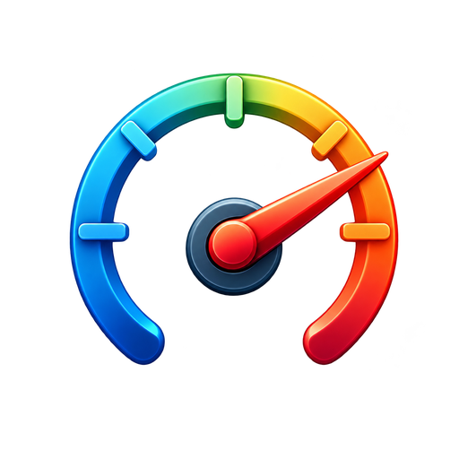
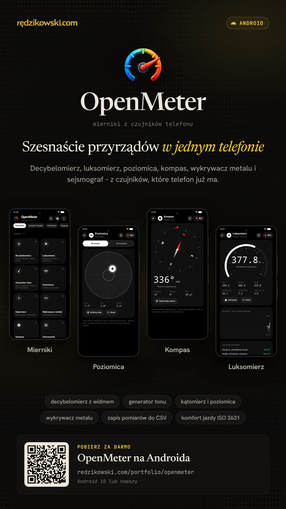

<p align="center">
  
</p>

# OpenMeter

<!-- posters:start -->
<p align="center">
  
</p>

<p align="center"><a href="https://redzikowski.com/portfolio/openmeter">redzikowski.com/portfolio/openmeter</a></p>
<!-- posters:end -->

Mierniki i czujniki telefonu w jednym miejscu – czarno-biały interfejs (ciemny AMOLED albo jasny), bez reklam, open source. Po polsku i po angielsku.

*Your phone's sensors as measuring instruments – black-and-white UI (AMOLED dark or light), no ads, open source. Available in English and Polish.*

Aplikacja pokazuje tylko te mierniki, dla których Twój telefon ma odpowiedni czujnik.

| Miernik | Czujnik | Co mierzy |
|---|---|---|
| Decybelomierz | mikrofon | poziom dźwięku dB(A)/dB(Z), Leq, widmo, spektrogram, dominująca częstotliwość i nuta |
| Luksomierz | światło | natężenie w lx, stopoświece, EV i czas naświetlania, zalecenia oświetlenia |
| Poziomica | grawitacja / akcelerometr | libella 2D i pozioma, spadek w % i mm/m, kalibracja |
| Kątomierz | grawitacja / akcelerometr | kąt krawędzi i nachylenie, zero względne, blokada |
| Wykrywacz metalu | magnetometr | pole w µT, odchyłka od tła, pikanie i wibracje |
| Kompas | wektor obrotu / magnetometr | azymut, kierunek, zapamiętany namiar |
| Sejsmograf | przyspieszenie liniowe | przebieg 3 osi, PGA, szacunkowa skala Mercallego |
| Drgania w podróży | przyspieszenie liniowe + grawitacja | RMS pion/poziom, komfort wg ISO 2631, widmo 1–30 Hz, wstrząsy |
| Generator tonu | głośnik | sinus, prostokąt, trójkąt i szum 20 Hz–20 kHz |
| Linijka | ekran | podziałka w cm i calach, przesuwane linie pomiarowe |
| Bateria | – | prąd, moc, napięcie, temperatura, stan, szacowana pojemność |
| Barometr | ciśnienie | hPa, wysokość, piętra, trend 3 h, historia 24 h |
| Klimat | temperatura / wilgotność | punkt rosy, wilgotność bezwzględna |
| Obrotomierz | żyroskop | obr/min, °/s w 3 osiach |
| Krokomierz | detektor kroków | kroki, kadencja, dystans |
| Zbliżenie | zbliżeniowy | blisko/daleko, licznik gestów |
| Kąt zawiasu | zawias (foldy) | rozłożenie składanego telefonu |
| Wszystkie czujniki | – | lista czujników z parametrami i odczytem na żywo |

Każdy pomiar można nagrać przyciskiem **REC** – plik CSV trafia do listy nagrań w aplikacji i do `Pobrane/OpenMeter`.
Ikona zakładki zapisuje pojedynczy odczyt w **dzienniku** (z datą, godziną i notatką); dziennik można wysłać jako CSV.

Do tego: motyw ciemny/jasny/systemowy, jednostki metryczne lub imperialne, wybór jednostki ciśnienia, alarm hałasu, cel i długość kroku, ulubione, wyszukiwarka i filtry kategorii.

## Języki / Translations

Teksty są w standardowych zasobach Androida:

- `app/src/main/res/values/strings.xml` – angielski (domyślny),
- `app/src/main/res/values-pl/strings.xml` – polski.

Aby dodać język, skopiuj `values/strings.xml` do `values-xx/strings.xml` (`xx` = kod ISO 639-1, np. `values-de`) i przetłumacz teksty. Nic więcej nie trzeba zmieniać: lista języków w ustawieniach aplikacji i w ustawieniach systemu (Android 13+) tworzy się przy budowaniu. Test `StringsTest` sprawdza, czy tłumaczenie jest kompletne i ma zgodne znaczniki (`%1$s`, `%d`).

*To add a language, copy `values/strings.xml` to `values-xx/strings.xml` and translate it – the app lists the new language automatically.*

## Instalacja

Pobierz najnowszy plik `OpenMeter-x.y.z.apk` z [Releases](https://github.com/BlackSingularities/OpenMeter/releases/latest) (Android 10+).
Aplikacja sama sprawdza nowe wydania i instaluje je jednym dotknięciem.

## Budowanie

Każdy wypchnięty tag `vX.Y.Z` buduje podpisany APK w GitHub Actions i publikuje wydanie.
Wersja pochodzi z pliku `VERSION`, opis wydania z `CHANGELOG.md`.

```bash
gradle :app:assembleDebug
```

## Licencja

MIT

---

**Projekt i wykonanie: [redzikowski.com](https://redzikowski.com)**

<a href="https://buycoffee.to/adamredzikowski" target="_blank"></a>
